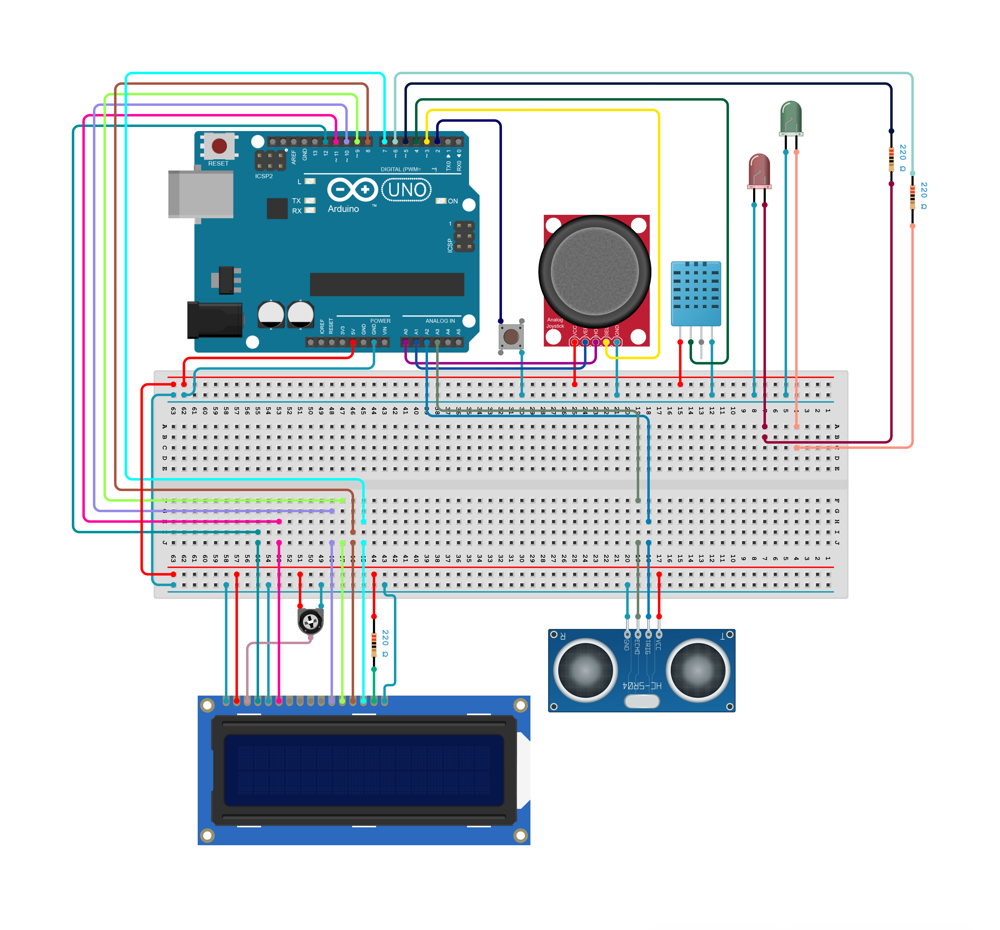
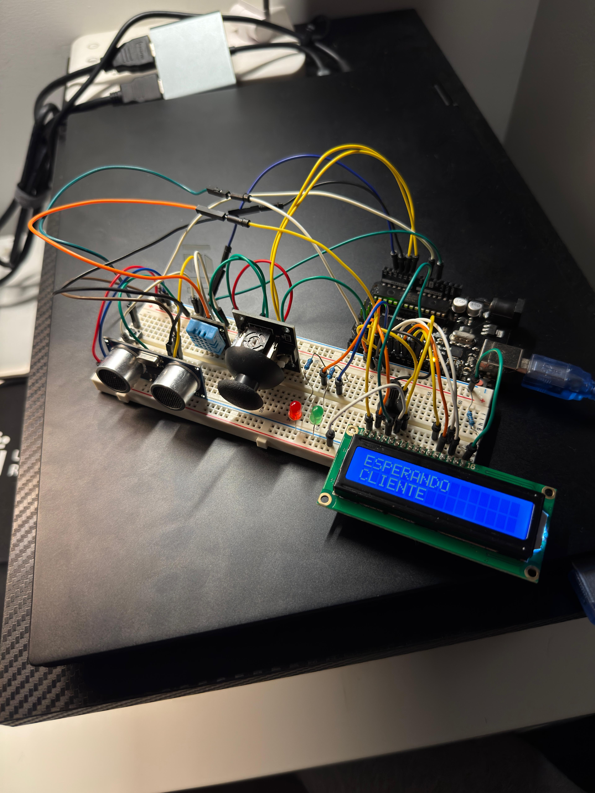

# Práctica 3: Controlador de una máquina expendedora

**Asignatura:** Sistemas Empotrados y de Tiempo Real (SETR)  
**Grado:** Ingeniería en Robótica Software — Universidad Rey Juan Carlos (URJC)  
**Autor:** Jorge Merás Ordax  

---

## 1. Introducción y objetivo

En esta práctica se ha diseñado y montado el hardware y el software de control de una máquina expendedora basada en una placa Arduino UNO con microcontrolador ATmega328P.

El sistema gestiona la interfaz de usuario, formada por una pantalla LCD, un joystick con botón, un pulsador externo y dos LEDs. También recoge información de un sensor de temperatura y humedad DHT11 y de un sensor de distancia por ultrasonidos HC-SR04. El programa se organiza en tres modos de funcionamiento: Arranque, Servicio y Administración.

## 2. Montaje hardware

### 2.1. Componentes utilizados

Se han utilizado los siguientes componentes del kit de laboratorio:

- Placa **Arduino UNO** y protoboard.
- **Pantalla LCD** y potenciómetro de 10 kΩ para ajustar el contraste.
- **Joystick analógico**, con ejes X e Y y botón integrado SW.
- **Sensor de temperatura y humedad DHT11**.
- **Sensor de distancia por ultrasonidos HC-SR04**.
- **Pulsador externo**, utilizado para cancelar el servicio y acceder al modo Administración.
- **Dos LEDs**, `LED1` y `LED2`, con resistencias de 220 Ω.

### 2.2. Asignación de pines

La asignación de pines tiene en cuenta las funciones del ATmega328P y los temporizadores utilizados por el programa:

| Componente | Pin del componente | Pin Arduino UNO | Justificación |
| :--- | :--- | :--- | :--- |
| **Pulsador externo** | Terminal 1 / 2 | **Pin 2** / GND | Permite utilizar la interrupción externa `INT0` y la resistencia interna `INPUT_PULLUP`. |
| **Joystick (botón)** | SW | **Pin 3** | Entrada digital con `INPUT_PULLUP`. |
| **Joystick (ejes)** | VRx / VRy | **A1** / **A0** | Entradas analógicas del ADC de 10 bits (valores de 0 a 1023). |
| **Sensor DHT11** | DATA | **Pin 4** | Comunicación digital con el sensor. |
| **LED1 (estado)** | Ánodo (+) | **Pin 5** | Salida digital, con resistencia de 220 Ω hacia GND. |
| **LED2 (progreso)** | Ánodo (+) | **Pin 6 (PWM)** | Salida PWM asociada a `Timer0`, adecuada para regular el brillo sin interferir con `TimerOne`, que utiliza `Timer1`. |
| **Pantalla LCD** | RS / E | **Pin 12** / **Pin 11** | Señales de control del LCD; el pin `RW` está conectado a GND. |
| **Pantalla LCD** | DB4 / DB5 / DB6 / DB7 | **10 / 9 / 8 / 7** | Bus de datos en modo de 4 bits. |
| **HC-SR04** | TRIG / ECHO | **A2** / **A3** | Los pines analógicos también se pueden utilizar como entradas y salidas digitales. |
| **Semilla aleatoria** | *(Sin conectar)* | **A5** | Lectura de una entrada analógica sin conectar para aportar variación a `randomSeed()`. |

El pin 6 pertenece a las salidas PWM controladas por `Timer0`. En el Arduino UNO, `TimerOne` utiliza `Timer1`, asociado a las salidas PWM de los pines 9 y 10. El pin 11 utiliza `Timer2`, por lo que no comparte ese temporizador. Los pines 9, 10 y 11 pueden seguir utilizándose como señales digitales para el LCD; la limitación afecta a la generación de PWM en los pines asociados a `Timer1`.

### 2.3. Montaje en el simulador: CirkitDesigner



### 2.4. Montaje real



### 2.5. Vídeo del funcionamiento

[Vídeo del funcionamiento](video.mp4)

---

## 3. Arquitectura software

El programa se ha organizado en **9 archivos** para separar la configuración, los periféricos y la lógica de funcionamiento. Cada periférico que se planifica de forma periódica tiene su propia clase heredada de `Thread`.

```text
Practica3/
├── Practica3.ino          -> Inicialización (setup) y bucle principal (loop)
├── Configuracion.h        -> Pines del hardware y periodos de muestreo
├── Catalogo.h             -> Estructura Producto, precios y opciones del menú
├── Interrupciones.h       -> Variables compartidas, ISR del pin 2 y rutina de TimerOne
├── LedThread.h            -> Control del parpadeo, estado y PWM de los LEDs
├── UltrasonidosThread.h   -> Medición de distancia con el HC-SR04
├── DHTThread.h            -> Lectura de temperatura y humedad
├── JoystickThread.h       -> Lectura de los ejes y detección de eventos del joystick
└── MaquinaEstados.h       -> Lógica de los modos Arranque, Servicio y Administración
```

Esta distribución permite localizar con más facilidad la parte del programa que controla cada componente y mantener separada la lógica de la máquina de estados.

---

## 4. Recursos de tiempo real utilizados

### 4.1. Multitarea cooperativa con `ArduinoThread`

El ATmega328P ejecuta una instrucción cada vez, por lo que no realiza varias tareas en paralelo. Para atender los periféricos con distintas frecuencias se ha utilizado la biblioteca `ArduinoThread`, que permite ejecutar de forma periódica las tareas cuando les corresponde.

Se han configurado, entre otros, los siguientes periodos: joystick cada 80 ms, sensor de distancia cada 200 ms, LED de arranque cada 1000 ms y DHT11 cada 1500 ms. La pantalla LCD y el PWM se actualizan desde la lógica del programa cuando es necesario.

Se ha evitado utilizar `delay()` en el flujo principal porque detendría la ejecución normal del programa durante la espera. Durante ese tiempo no se procesarían los eventos del joystick ni se actualizarían los estados de la máquina. En su lugar, las fases temporizadas se controlan mediante `millis()`, de modo que el bucle principal puede seguir atendiendo las demás tareas.

Se ha elegido `ArduinoThread` para organizar las tareas periódicas en clases independientes. También sería posible gestionar los periodos mediante comprobaciones manuales de `millis()` en `loop()`, pero en ese caso habría que mantener y actualizar los temporizadores de cada tarea dentro del bucle principal.

El funcionamiento de los hilos se organiza de la siguiente manera:

1. Cada periférico tiene su clase heredada de `Thread` (`LedThread`, `UltrasonidosThread`, `DHTThread` y `JoystickThread`). En ellas se implementan los métodos `shouldRun()` y `run()` de acuerdo con la biblioteca utilizada.
2. En cada iteración de `loop()`, `controller.run()` comprueba qué hilos deben ejecutarse y llama a los que corresponda. La planificación es cooperativa: si una tarea permanece bloqueada, las demás no pueden ejecutarse hasta que termine.
3. Los hilos se pueden activar o desactivar según el modo de funcionamiento. Por ejemplo, `led1Thread` se desactiva cuando termina la secuencia de arranque (`enabled = false`). `led2Thread` permanece desactivado porque el brillo de `LED2` se controla directamente mediante PWM o mediante un estado fijo.

| Hilo (`Thread`) | Intervalo | Motivo de la periodicidad |
| :--- | :---: | :--- |
| `LedThread` (`led1Thread`) | **1000 ms** | Realiza un cambio de estado por segundo durante la secuencia de arranque. Se cuentan seis cambios para completar tres ciclos de encendido y apagado. |
| `UltrasonidosThread` | **200 ms** | Realiza cinco mediciones por segundo, suficientes para actualizar la detección de presencia y la información mostrada en Administración. |
| `DHTThread` | **1500 ms** | Respeta un intervalo adecuado para el DHT11, cuya frecuencia de lectura es limitada. |
| `JoystickThread` | **80 ms** | Permite detectar los movimientos del joystick con una respuesta fluida sin realizar lecturas continuas del ADC. |

### 4.2. Interrupciones externas y temporizador `TimerOne`

#### Interrupciones frente a *polling*

Con *polling*, el programa comprueba repetidamente el estado del pulsador. Una interrupción permite responder a un cambio en el pin sin tener que comprobarlo continuamente desde el bucle principal. Esto resulta útil cuando el programa también realiza lecturas de sensores u otras tareas que pueden ocupar parte del tiempo de ejecución.

#### Interrupción externa `INT0` en el pin 2

El pulsador externo está conectado al pin 2 y utiliza la interrupción `INT0` en modo `CHANGE`, por lo que se detectan tanto los cambios al pulsar como al soltar el botón.

La rutina `isrBotonExterno()` debe ser breve. Registra el instante del cambio, aplica el antirrebote y actualiza las variables compartidas que utiliza el programa principal. No se realizan esperas dentro de la ISR.

Los contactos de un pulsador mecánico pueden generar varios flancos durante unos milisegundos al cambiar de estado. Para reducir estos falsos cambios se aplica un antirrebote de **40 ms**, ignorando los cambios que se producen antes de que transcurra ese intervalo desde el último cambio aceptado.

Las variables que se comparten entre las interrupciones y el programa principal se declaran `volatile`, entre ellas `contadorSegundos`, `tPresionBtnExt`, `tUltimoCambioISR`, `btnExtPresionado`, `flagCancelarServicio` y `flagToggleAdmin`. Esta declaración evita que el compilador mantenga en un registro un valor que puede cambiar fuera del flujo normal del programa. No obstante, `volatile` no garantiza que una operación sobre una variable de varios bytes sea atómica; las lecturas de esas variables deben protegerse cuando puedan coincidir con una actualización desde una ISR.

Durante la ejecución de una ISR, las interrupciones globales permanecen deshabilitadas. Por ello, la interrupción de `Timer0` que actualiza `millis()` no puede ejecutarse mientras se atiende la ISR. `millis()` no avanza dentro de ella y `delay()` no debe utilizarse en ese contexto. Esta es otra razón para mantener las rutinas de interrupción lo más cortas posible.

#### Temporizador `Timer1` y prevención de conflictos con PWM

El ATmega328P dispone de tres temporizadores hardware: `Timer0`, `Timer1` y `Timer2`. En esta práctica se utiliza `Timer1` mediante la biblioteca `TimerOne` para generar una interrupción periódica de un segundo.

- **`Timer0` (8 bits):** el núcleo de Arduino lo utiliza para funciones como `millis()`, `micros()` y `delay()`. También controla el PWM de los pines **5 y 6**, cuya frecuencia en el Arduino UNO es de aproximadamente **980 Hz**. Por eso `LED2` se conecta al pin 6: su brillo puede regularse mediante PWM sin utilizar `Timer1`.
- **`Timer1` (16 bits):** se utiliza con `TimerOne`, configurado con un periodo de **1 000 000 µs (1 segundo)** para ejecutar `isrTimer1Segundo()` e incrementar `contadorSegundos`. Al utilizar `Timer1`, el PWM de los pines **9 y 10** deja de estar disponible para su uso normal. Estos pines se emplean como señales digitales del LCD, no para generar PWM.
- **`Timer2` (8 bits):** controla el PWM de los pines **3 y 11**. Por tanto, el pin 11 no comparte temporizador con `TimerOne` y puede utilizarse como señal digital `E` del LCD.

### 4.3. Mecanismo de seguridad: Watchdog Timer

El **Watchdog Timer (WDT)** es un temporizador interno del ATmega328P que utiliza un oscilador independiente del reloj principal. Si el programa no reinicia el contador del Watchdog mediante `wdt_reset()` dentro del tiempo configurado, el microcontrolador provoca un reinicio.

#### Configuración en `WDTO_4S`

Al principio de `setup()` se llama a `wdt_disable()` y después a `wdt_enable(WDTO_4S)`. En cada iteración del bucle principal se ejecuta `wdt_reset()` para indicar que el programa continúa funcionando.

Se ha elegido un tiempo de **4 segundos** para permitir que terminen las tareas normales y, al mismo tiempo, reiniciar la placa si el programa queda bloqueado. El tiempo total de cada iteración depende de las operaciones que se ejecuten y debe comprobarse en el montaje real; por ello, no se considera una garantía un tiempo máximo que no se haya medido.

#### Funcionamiento del Watchdog

Si una llamada dentro de `controller.run()` o `actualizarMaquinaExpendedora()` no devuelve el control al bucle principal, no se ejecutará `wdt_reset()`. Cuando transcurran los cuatro segundos configurados, el Watchdog reiniciará la placa.

El mismo mecanismo puede actuar durante la parte de `setup()` que se ejecuta después de habilitar el Watchdog. Por ejemplo, si la inicialización de un periférico quedara bloqueada durante más tiempo que el configurado, se produciría un reinicio. También puede actuar si el procesador permanece atrapado en una ISR, ya que el Watchdog utiliza un oscilador independiente.

#### Casos que no detecta el Watchdog

El Watchdog comprueba que el programa siga llegando a `wdt_reset()`, pero no detecta todos los errores. Por ejemplo:

- **Errores de lógica que no bloquean el bucle:** si una condición impide salir de un estado, como `SERV_ESPERA`, pero el programa continúa ejecutando `loop()` y `wdt_reset()`, el Watchdog no detectará el problema.
- **Sensores desconectados que devuelven un error rápidamente:** si `readTemperature()` devuelve `NaN` o `pulseIn()` devuelve `0` al agotar su tiempo de espera, el programa puede continuar y reiniciar el Watchdog con normalidad.
- **Problemas anteriores a su activación:** el Watchdog no protege el código que se ejecuta antes de `wdt_enable(WDTO_4S)`, ni el proceso previo del bootloader.
- **Fallos físicos o datos incorrectos:** un LED fundido, un contraste incorrecto del LCD o un precio mal configurado no provocan necesariamente un bloqueo del microcontrolador.

#### Puntos del código que requieren especial atención

Los siguientes puntos pueden afectar al tiempo de respuesta del programa y conviene revisarlos al modificar el proyecto:

1. **`UltrasonidosThread.h` (`pulseIn(pinEcho, HIGH, 25000)`):** `pulseIn()` espera el pulso de eco y, en este caso, tiene un tiempo máximo de espera de **25 000 µs (25 ms)**. Este límite evita una espera indefinida si no llega el eco. El valor `0` indica que no se ha recibido el pulso dentro del tiempo establecido y debe tratarse como una lectura no válida.
2. **`DHTThread.h` (`dht.readTemperature()` / `dht.readHumidity()`):** la lectura del DHT11 utiliza temporizaciones precisas para recibir los 40 bits del sensor. Estas operaciones pueden ocupar temporalmente el procesador, por lo que conviene mantener el intervalo de lectura y evitar ejecutarlas más veces de las necesarias.
3. **`Interrupciones.h` (`isrBotonExterno`):** la ISR debe realizar el mínimo trabajo posible. Una frecuencia excesiva de interrupciones podría impedir que el programa principal vuelva a ejecutarse con normalidad y llegue a `wdt_reset()`.
4. **`MaquinaEstados.h`:** no deben introducirse bucles de espera que puedan quedarse ejecutándose indefinidamente. Si el programa no vuelve al bucle principal, el Watchdog podrá reiniciar la placa cuando venza el tiempo configurado.

---

## 5. Funcionamiento de los modos de operación

### 1. Modo Arranque (`MODO_ARRANQUE`)

Al encender o reiniciar el Arduino, la pantalla LCD muestra `CARGANDO ...`. Mientras tanto, `led1Thread`, configurado con un intervalo de 1000 ms, cambia el estado de `LED1`. Cuando `led1Thread->cambiosRealizados` alcanza el valor **6**, se han realizado seis cambios de estado, que corresponden a tres ciclos de encendido y apagado. Al terminar la secuencia, se llama a `entrarModoServicio()`, se desactiva el hilo con `led1Thread->enabled = false`, se apaga `LED1` y se pasa al Modo Servicio.

### 2. Modo Servicio (`MODO_SERVICIO`)

Es el modo normal de funcionamiento de la máquina. Se divide en cinco subestados, controlados mediante `millis()`:

- **Detección de presencia (`SERV_ESPERA`):** mientras la distancia medida sea igual o superior a 100 cm, la pantalla muestra `ESPERANDO CLIENTE`. Cuando se detecta una presencia a menos de 100 cm, se guarda el instante en `tInicioFase` y se pasa al siguiente estado. Las lecturas no válidas del sensor deben descartarse antes de aplicar este umbral.
- **Lectura del entorno (`SERV_ENTORNO`):** se muestran la temperatura en grados Celsius y la humedad en porcentaje, obtenidas del DHT11. Esta información se presenta durante **5 segundos**, con una actualización de la pantalla cada segundo.
- **Catálogo y selección (`SERV_CATALOGO`):** después de esos cinco segundos se muestran las cinco bebidas definidas en `Catalogo.h`, con sus precios:
  - `Café Solo`: **1,00 €**
  - `Café Cortado`: **1,10 €**
  - `Café Doble`: **1,25 €**
  - `Café Premium`: **1,50 €**
  - `Chocolate`: **2,00 €**

  El usuario recorre la lista de forma circular moviendo el joystick hacia arriba o abajo (`JOY_UP` / `JOY_DOWN`) y selecciona una bebida con el botón integrado (`JOY_CLICK`).
- **Preparación (`SERV_PREPARANDO`):** al confirmar la bebida se genera un tiempo pseudoaleatorio de preparación entre **4000 y 8000 ms**, mediante `random(4000, 8001)`. La función `randomSeed(analogRead(PIN_SEED))` se utiliza en `setup()` para inicializar el generador. La pantalla muestra `Preparando Cafe...` y, durante esta fase, se calcula el tiempo transcurrido con `millis()`. Ese valor se transforma al rango PWM de 0 a 255 mediante `map()`, aumentando progresivamente el brillo de `LED2` (pin 6) hasta completar la preparación.
- **Retirada (`SERV_RETIRE`):** cuando termina el tiempo de preparación, se apaga `LED2` y la pantalla muestra `RETIRE BEBIDA` durante **3 segundos**. Después, la máquina vuelve a `SERV_ESPERA`.
- **Cancelación mediante el pulsador externo:** durante las fases comprendidas entre `SERV_ENTORNO` y `SERV_RETIRE`, una pulsación mantenida entre **2 y 3 segundos** activa `flagCancelarServicio`. El programa cancela la operación en curso, apaga `LED2` y vuelve a `SERV_ESPERA`, sin reiniciar físicamente la placa.

### 3. Modo Administración (`MODO_ADMIN`)

Este modo permite consultar los sensores y modificar los precios de las bebidas sin cambiar el código fuente:

- **Acceso y salida (pulsación de 5 segundos o más):** se puede acceder desde cualquier modo manteniendo pulsado el botón externo durante al menos **5000 ms**. La función `verificarPulsacionLargaAdmin()` comprueba esta duración y realiza el cambio al Modo Administración. Para salir y volver al Modo Servicio se utiliza la misma pulsación.
- **Indicadores:** al entrar mediante `entrarModoAdmin()`, `LED1` y `LED2` permanecen encendidos mientras la máquina está en este modo.
- **Menú (`ADM_MENU`):** la pantalla muestra cuatro opciones: `a.Ver temp`, `b.Ver distancia`, `c.Ver contador` y `d.Modif precios`. Se recorren con el joystick hacia arriba y abajo y se seleccionan con `JOY_CLICK`. El movimiento hacia la izquierda (`JOY_LEFT`) permite volver a la pantalla anterior.
  1. **Ver temperatura (`ADM_TEMP`):** muestra las lecturas del DHT11 (`Temp: XX C` y `Hum: YY %`) y actualiza la información cada **500 ms**.
  2. **Ver distancia (`ADM_DIST`):** muestra la distancia medida por el HC-SR04 y actualiza el dato cada **250 ms**.
  3. **Ver contador (`ADM_CONT`):** muestra los segundos transcurridos desde el encendido de Arduino, almacenados en `contadorSegundos` y actualizados por la interrupción de `Timer1`.
  4. **Modificar precios (`ADM_SEL_PRECIO` → `ADM_EDIT_PRECIO`):** permite seleccionar un producto y copiar su precio a `precioTemp`. Al mover el joystick hacia arriba o abajo, el precio aumenta o disminuye en pasos de **0,05 €**. Al pulsar el botón se guarda el nuevo valor en `catalogo[indiceProd].precio`. El cambio se mantiene mientras la placa esté encendida, ya que no se utiliza EEPROM para guardar los precios. Si se mueve el joystick hacia la izquierda, se descartan los cambios y se vuelve a la lista de productos.

---

## 6. Conclusiones

En esta práctica se ha diseñado y montado una máquina expendedora con Arduino UNO. Se ha trabajado con entradas analógicas, salidas PWM, interrupciones, temporizadores, tareas cooperativas y el Watchdog.

La separación del programa en archivos y clases para los periféricos ha facilitado organizar el código y depurar cada parte. Para gestionar las tareas periódicas se ha utilizado `ArduinoThread`, mientras que las fases de funcionamiento se controlan mediante `millis()` en lugar de detener el programa con `delay()`.

También se ha utilizado la interrupción externa `INT0` para detectar las pulsaciones del botón y `TimerOne` para actualizar el contador de segundos. La elección del pin 6 para `LED2` permite regular su brillo mediante PWM de `Timer0` sin interferir con `Timer1`, que se utiliza para generar la interrupción periódica. Además, el Watchdog se ha configurado a cuatro segundos para reiniciar la placa si el programa deja de ejecutarse con normalidad.

Por último, el paso de la simulación en CirkitDesigner al montaje real en protoboard ha permitido detectar algunos problemas que no se aprecian igual en el simulador, como el ajuste del contraste del LCD, los rebotes del pulsador y la necesidad de establecer una zona muerta en los ejes del joystick para evitar movimientos no deseados en el menú.
